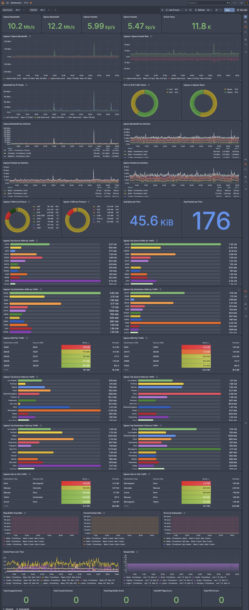
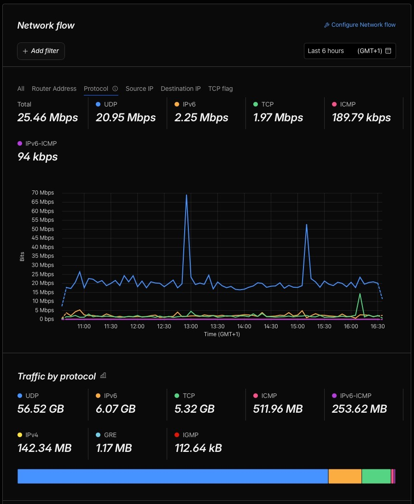

# RFM

Binary Cache:

- Cache: <https://cache.ysun.co>
- Key: `cache.ysun.co-1:WxPYwT5g3kt9XhUhHPpNLZKI9HIOsVVAuqSHpok8Qt4=`

RFM (Router Flow Monitor) is an eBPF-based network flow analysis agent for Linux
routers. It attaches TC programs to network interfaces, collects per-flow
traffic statistics with configurable sampling, optionally enriches flows from a
live BMP-fed RIB and/or MMDB ASN/city databases, and exports the results to
Prometheus and IPFIX.

Requirements:

- Linux 6.12 or newer ([integration tested](integration/versions.nix))
- Go 1.26.3+
- Root or `CAP_BPF` + `CAP_NET_ADMIN` + `CAP_PERFMON`

Current scope:

- Attaches TC programs for bidirectional flow observation (the BPF programs read
  their settings from a global and keep no per-flow state)
- Counts wire packets and wire bytes, unfolding GRO and GSO skbs from `gso_segs`
  into the packets after segmentation
- Parses IPv4 and IPv6 traffic on ethernet, VLAN, and QinQ links, and walks IPv6
  extension headers to the transport ports
- Attaches interfaces as they appear and detaches them as they go, keeps the
  counters across restarts when pinned in bpffs
- Optionally enriches flows in userspace with BMP/RIB data, MMDB data, or both,
  the MMDB files are re-opened when an updater replaces them
- Exports Prometheus metrics with monotonic flow counters per label tuple
- Optionally exports flows to one UDP IPFIX collector, on eviction and as
  interval records on an active timeout, from a bounded queue that packs records
  into sized messages
- Changes the sample rate at runtime, by hand or adaptively when the ring
  buffers drop events
- Optionally keeps no interface counters. When enabled, an skb the sampling
  passes over costs only the draw
- Unix socket control plane with birdc style subcommands
- NixOS module and VM tests

RFM daemon (`rfm agent`) loads eBPF programs, collects flow events in userspace,
and serves Prometheus metrics over HTTP.

```
+------------------------------------+
|            kernel                  |
|  TC ingress --+                    |
|               +---> per CPU rings ----> userspace collector
|  TC egress  --+                    |
|                                    |
|  per CPU iface counters --------------> Prometheus /metrics
+------------------------------------+
```

BPF programs are loaded via TCX as link-based attachments, the ingress program
at the head of an interface's TCX chain and the egress program at its tail. They
only observe: every path returns `TCX_NEXT`, which lets later TCX programs and
the filters of a clsact or ingress qdisc run. The programs keep no per-flow
state. The sample rate and the wakeup batch live in `rfm_cfg`, a global of the
programs that the agent maps into its memory, and the agent writes a new sample
rate there without reloading the programs.

### Data path

1. TC programs classify each skb by direction, protocol family, and 5-tuple
   after ethernet, VLAN, and QinQ parsing, past IPv4 options and up to six IPv6
   extension headers. Every skb updates the per-CPU counters of its interface,
   held in a counter slot or, for an interface without a slot, in a hash (see
   `iface_stats_size`). GRO on ingress and GSO on egress hand the hook one skb
   that stands for several wire packets, so the program adds `gso_segs` packets
   and the header bytes the merge removed. The kernel adds those header bytes to
   `wire_len` on egress, and on ingress from Linux 6.19. Otherwise the program
   parses the headers to compute them. The counters therefore count wire packets
   after segmentation, and on egress before the qdisc, which may still drop
   them. A VLAN tag the kernel holds in the skb rather than in the frame adds
   its 4 bytes to every wire packet. Sampled IP skbs, 1 in N on average (see
   `sample_rate`), emit a flow event to the ring buffer of their CPU carrying
   the same wire packet and byte counts, or with `stage_events` above 1 to a
   per-CPU stage that goes to the ring as one record. Non-initial IPv4 and IPv6
   fragments keep the IP protocol but export `src_port=0` and `dst_port=0`
   because later fragments do not carry the transport header. With
   `sampled_only` the programs draw the sample first, parse only the skbs it
   selects, and keep no interface counters.
2. The userspace collector reads the per-CPU ring buffers as one stream, taking
   up to 64 records from one ring buffer before it moves to the next nonempty
   one. It scales each event by the sample rate that was in force when it was
   sampled and aggregates flows into an in-memory table keyed by
   `(ifindex, direction, protocol, src/dst address, src/dst port)`. The table
   keeps the `CLOCK_BOOTTIME` timestamps of the events, which a step of the wall
   clock does not move, and the IPFIX exporter and `rfm flows` convert them to
   wall clock time. Enrichment labels are resolved once when a flow is created
   and stay with it. An event that fails to decode is counted as a `ring_buffer`
   error and skipped. When reading and recording keep the collector's loop busy
   for 85% of a 100 millisecond window, the loop hands batches of about 1024
   events to a second goroutine that records them, so the agent can use more
   than one core, and it records inline again once the two together use less
   than half a core.
3. Flows are evicted after a configurable idle timeout. Under high load, when
   the flow table is full, the flow with the oldest last-seen timestamp is
   forcibly evicted. An event moves its flow in that order at most once per 1/32
   of the idle timeout, so the order and the idle sweep hold to within that
   slack. A flow that keeps going is exported as an interval record every
   `active_timeout` while it stays in the table.
4. At scrape time, the Prometheus exporter reads the BPF interface counters
   directly and copies the label tuples the collector keeps current, without
   walking the flow table. A tuple gives monotonic counters per interface,
   direction, protocol, and enrichment labels (ASN, city) that never reset when
   flows are evicted. With no enrichment configured, those labels stay empty and
   the agent still runs normally.
5. When IPFIX is enabled, flow records are queued for a sender that packs them
   into messages no larger than `max_message_size`, refreshes templates, and
   sends. Every record carries the sampled packets and their IP bytes since the
   previous record of the same flow, with the sampling probability that scales
   them. A failed dial is not fatal and is retried with backoff, so the agent
   starts before its bind address exists. The exporter excludes only the tuples
   of its current and previous socket from recursive self-export.
6. When a control socket is configured, `rfm status`, `rfm flows`, `rfm rib`,
   `rfm set`, `rfm config` and `rfm reload` talk to the running agent.

### Startup and shutdown

`rfm agent` sets up its parts in this order and exits with status 1 at the first
one that fails: the configuration, the lock on `pin_path`, the control socket,
the BMP listener and the MMDB files, the BPF programs with the pinned counters,
the IPFIX exporter, and the metrics listener. A second agent on the same
`pin_path` or control socket therefore stops before it loads anything.

No interface has to match at start. The interface watcher attaches the matching
links of its first link dump and every matching link that appears later, and the
agent logs a warning when that dump attached nothing and for every pattern that
matched no link. The metrics port opens once the watcher has gone through its
first link dump, and the first scrape then shows the counters of the interfaces
it attached. Each counter appears with the first packet of its direction and
family, or at once when an earlier run pinned it. While a failing dump is
retried the port stays closed, and the control socket answers meanwhile.

A running agent exits with status 1 when one of its parts fails: the watcher
cannot open its first link subscription, the control socket or the BMP listener
stops on an accept error that is not temporary, the metrics server fails, or a
ring buffer cannot be read. A later link subscription that fails is opened
again. SIGINT and SIGTERM end the agent with status 0. With IPFIX enabled it
first exports the flows still in the table with flowEndReason 0x04 and sends the
queued records.

## Configuration

RFM reads a TOML config file (default `/etc/rfm/rfm.toml`). Unknown keys are
rejected at load time. Example:

```toml
[agent]
interfaces = ["eth0", "enp.*"]

[agent.bpf]
sample_rate = 100
adaptive_sampling = false
max_sample_rate = 1000
pin_path = "/sys/fs/bpf/rfm"

[agent.collector]
max_flows = 65536
eviction_timeout = "30s"
active_timeout = "60s"

[agent.ipfix]
host = "127.0.0.1"
port = 4739
template_refresh = "60s"
observation_domain_id = 1
max_message_size = 1200

[agent.control]
socket = "/run/rfm/rfm.sock"

[agent.ipfix.bind]
host = "192.0.2.10"
port = 0

[agent.prometheus]
host = "::1"
port = 9669

[agent.enrich.mmdb]
asn_db = "/var/lib/rfm/dbip-asn-lite.mmdb"
city_db = "/var/lib/rfm/dbip-city-lite.mmdb"

[agent.enrich.rib.bmp]
host = "127.0.0.1"
port = 11019
```

### `agent`

`interfaces` (required, list of strings): Network interfaces to attach BPF
programs to. Each entry is a Go regex matched against system interface names
with implicit full-string anchoring. Use `[".*"]` for every interface,
`["enp.*"]` for the enp prefix, or list exact names like `["eth0", "wlan0"]`. A
pattern that reads like a shell glob draws a warning at start, as a regex `eth*`
matches `et`, `eth` and `ethh` but not `eth0`.

Patterns may overlap. For example `["eth0", "eth.*"]` matches `eth0` once even
though both patterns apply, and a TC program is attached at most once per
interface. The agent follows the links over netlink. It attaches every matching
link of its first link dump and every matching link that appears later, and
detaches a link that goes away or that a rename takes out of the patterns. The
counters of a detached link are dropped with it. A matching link without an
ethernet header, such as a WireGuard, tun (`tailscale0`) or xfrm interface, is
skipped with a warning, because the programs would read its IP header as
ethernet. An attach that finds the link already gone is only logged as a
warning, as the removal of the link follows. Any other failed attach is tried
again after a pause that doubles from 100 milliseconds up to 30 seconds, until
the link goes away or a rename takes it out of the patterns. Every failed try
counts as an `attach` error.

The agent starts when no interface matches yet, see
[Startup and shutdown](#startup-and-shutdown). A pattern that fails to compile
as a regex is rejected at config load.

### `agent.bpf`

`sample_rate` (uint32, default 100): Sample 1 in N skbs on average for flow
events. An interface with a counter slot samples after a gap drawn uniformly
between 1 and 2N-1 skbs, one random draw per sample, and the interfaces without
a slot share one such gap per CPU. With `sampled_only` each CPU keeps one gap
over all its skbs, non-IP included, and the IP skbs keep the same average rate.
A new rate applies from the next skb. After GRO or before GSO one skb stands for
several wire packets, and its event carries all of them. Must be greater than 0.
A value of 1 samples every skb. Higher values reduce ring buffer throughput at
the cost of flow granularity.

`ring_buf_size` (int, default 0): Size in bytes of the BPF ring buffer of each
CPU. The agent creates one ring buffer per possible CPU, and together they take
this size times the CPU count. `0` derives it from `sample_rate`: 256 KiB at 1
in 1, half as much for each doubling of the rate, and 64 KiB from 1 in 4 on, so
a ring holds about as long a burst of one CPU's packets up to 1 in 4, and its
batch of 512 events keeps the wakeups of a busy CPU few at higher rates. The
derived size is never below the page size. A set size must be a power of two and
a multiple of the page size, and invalid values are rejected at config load
time. Larger buffers reduce the chance of dropped events under burst traffic.
The size follows the configured `sample_rate`, so a rate lowered at run time
with `rfm set sample-rate` can overflow a ring sized for a higher one, which
shows in `rfm_collector_dropped_events_total`.

`wakeup_batch` (uint32, default 0): The BPF program flags ring buffer submits
with `BPF_RB_NO_WAKEUP` and forces a wakeup once every N events on each CPU, a
staged record counting every event it carries. The count runs over every
interface, direction and family of the CPU, as its ring buffer does. The
collector drains every ring buffer on any wakeup. Lower values reduce flow event
delivery latency at the cost of more userspace wakeups. Higher values amortize
wakeups, and an event submitted without one waits for the collector's 100
millisecond read deadline at most. `0` derives half of the events the ring
holds, at 64 bytes an event, 2048 for a ring of 256 KiB. A set batch must be at
most that half, which leaves the collector the other half of the ring to catch
up in after the wakeup, less the `stage_events` - 1 events the staged record
that crosses the batch can carry past it. A set batch with `ring_buf_size` at 0
doubles the derived ring until it holds twice the batch, up to 64 MiB, past
which a batch above 524288 events is refused.

`iface_stats_size` (int, default 0): Override the BPF iface stats hash map
capacity, in keys. Up to `iface_slots` attached interfaces with an ifindex below
16384 count in counter slots of their own, and the hash counts the others. The
hash takes kernel memory only for the keys in use. `0` keeps the 4096 keys the
program declares, or the capacity of a pinned hash. An interface takes up to six
keys, one per direction and family, which makes 4096 keys enough for about 680
interfaces beyond the slots. A counter update the full map refuses leaves that
traffic uncounted and counts as a `bpf_map` error. Set it explicitly when
running on a router with more subinterfaces than that. With `pin_path` set, a
set size that differs from the pinned one fails the start until the old pin is
removed, see `pin_path`.

`iface_slots` (int, default 0): Counter slots of the per-CPU counter array, up
to 256. `0` keeps 16, or the slots of a pinned array. Each slot holds six
counters on every possible CPU, about 7 KB on a host of 36 CPUs, and an
interface past the slots counts in the iface stats hash, which costs a hash
lookup per packet. With `pin_path` set, a set count that differs from the pinned
one fails the start until the old pin is removed.

`adaptive_sampling` (bool, default false): Let the collector double the sample
rate, up to `max_sample_rate`, after every sweep that saw a ring buffer drop
events, and halve it back toward `sample_rate` after ten quiet sweeps in a row.
Every event is scaled by the rate that sampled it, and IPFIX records carry the
effective `samplingProbability`, so estimates stay unbiased. A rate set with
`rfm set sample-rate` becomes the one adaptive sampling goes on from. A sample
rate the probe refuses counts as a `bpf_map` error. Leave it off when the IPFIX
collector applies its own fixed sampling rate.

`max_sample_rate` (uint32, default 1000): Upper bound for the adaptive rate and
for a rate set with `rfm set sample-rate`. Must be at least `sample_rate`.

`sampled_only` (bool, default false): Drop the interface counters. The programs
draw the sample before parsing and parse only the skbs it selects. The
`rfm_interface_*` metrics disappear and the flow metrics stay. A change takes
effect at the next start.

`stage_events` (uint32, default 1): Sampled events each CPU gathers before it
writes them to its ring buffer as one record. `1` writes every event as a record
of its own. From 2 to 32 the programs keep up to that many events of a CPU in a
per-CPU stage and write them as one record of 56 bytes per event, which takes
one ring buffer write and its lock per record in place of one per event. A stage
that does not fill is written by a timer of its CPU 10 milliseconds after the
timer was armed, so an event waits at most that long before the collector can
read it. A CPU that goes offline keeps the events of its stage, written or
dropped by neither, until it runs the programs again after it comes back. More
than 1 needs `bpf_timer_start` to take `BPF_F_TIMER_CPU_PIN`, which Linux 6.7
and later do on kernels without PREEMPT_RT, and the agent refuses to start
otherwise. A change takes effect at the next start.

`pin_path` (string, default ""): A bpffs directory where the interface counters
are pinned. A restart or upgrade reuses the pinned maps, so the counters stay
monotonic across it. The NixOS module sets `/sys/fs/bpf/rfm`. Empty keeps the
maps private to the process. The agent creates the directory and holds a lock on
it, and a second agent on the same `pin_path` refuses to start. A pinned map
whose size the config sets and that differs from it, or whose layout another
build changed, fails the start with an error that names the difference. With
`iface_stats_size` and `iface_slots` at 0 the agent takes the sizes of the
pinned maps, and a pinned hash keeps its own preallocation, so an upgrade that
changes a default keeps the counters until a reboot clears the pins. To start
the counters from zero, remove the pin files `rfm_iface_stats`, `rfm_iface_slot`
and `rfm_iface_arr` in the directory, or reboot. An upgrade from a build without
counter slots, which pinned `rfm_iface_stats` alone, keeps that pin with its
counters and needs no reboot. `rfm_iface_slot` pinned without `rfm_iface_arr`,
or the reverse, is removed with a warning, and the slotted counters start from
zero. A build from before `iface_slots` compares the pins strictly and refuses
the ones a later build creates, a hash without preallocation and an array sized
to the slots, so going back to it needs the pin files removed or a reboot. With
`sampled_only` the agent leaves the pins untouched for the next start without
it. After its first link dump the agent deletes the pinned counters of every
interface it neither attached nor keeps retrying.

### `agent.collector`

`max_flows` (int, default 65536): Maximum number of active flows held in memory.
Must be greater than 0. When the table is full, the flow that went longest
without an event, to within 1/32 of the eviction timeout, is forcibly evicted
and, with IPFIX enabled, exported with flowEndReason 0x05. The same number
limits the room for new label tuples with enrichment labels in the flow metrics,
see [Prometheus metrics](#prometheus-metrics). A held flow takes about 270 bytes
of the agent's memory, garbage collector headroom included, so a full default
table holds about 18 MB.

`eviction_timeout` (string, default "30s"): How long a flow can be idle before
eviction. Accepts any Go duration string (e.g. "10s", "1m", "2s"). Minimum value
is 1s. The collector sweeps the table every half eviction timeout, or more often
when `active_timeout` asks for it, and a flow leaves within one sweep after its
timeout. A label tuple leaves the scrape after ten eviction timeouts without
traffic.

`active_timeout` (string, default "60s"): How often a flow that keeps seeing
traffic is exported over IPFIX as an interval record (flowEndReason 0x02) while
it stays in the table. Each record carries the packets and bytes since the
previous record, so a collector sums them. `"0s"` disables it, otherwise the
minimum is 1s. The collector sweeps at the active timeout split into the fewest
equal parts no longer than half the eviction timeout, so the records of a flow
go out one active timeout apart, an active timeout of 40s with the default
eviction timeout sweeps every 13.3 seconds.

### `agent.ipfix`

`host` (string, default ""): Collector host for UDP IPFIX export. If
`agent.ipfix.host` and `agent.ipfix.port` are both unset, IPFIX export stays
disabled.

`port` (int, default 0): Collector UDP port for IPFIX export. If only one IPFIX
field is set, the other defaults to `::1` or `4739`.

`bind.host` (string, default ""): Local source address for the exporter UDP
socket. When unset, the kernel picks the source address from routing. A bind
address is rejected unless `host` or `port` of the collector is set.

`bind.port` (int, default 0): Local source port for the exporter UDP socket. `0`
uses an ephemeral port chosen by the kernel.

`template_refresh` (string, default "60s"): How often UDP IPFIX templates are
re-sent. Accepts any Go duration string. Minimum 1s. The templates also go out
before the first data record on every new socket. RFC 7011 requires UDP
exporters to re-send templates regularly because the transport is lossy. The
default of 60s lets a collector that lost a template or restarted recover within
one refresh window.

`observation_domain_id` (uint32, default 1): IPFIX observation domain id placed
in exported message headers. Must be > 0. Set distinct values when multiple RFM
agents export to one collector and downstream needs to demultiplex by source.

`max_message_size` (int, default 1200): Largest IPFIX message in bytes, between
171 and 65535. A message carries at least one record, and 171 bytes hold an IPv6
record with its template. The message is the UDP payload. Keep it at most the
path MTU, including any tunnel the exporter traffic crosses, minus 28 bytes for
the IPv4 and UDP headers or 48 bytes for the IPv6 and UDP headers, so messages
never fragment.

The exporter queues up to `max_flows` or 4096 records, whichever is larger,
enough for one eviction sweep of a full table. A full queue drops the newest
record and counts it, and flow collection never waits on a slow socket. The
agent logs the first drop at once and later ones at most once a minute, each
line with the count since the previous one. The sender gathers records for up to
1 second before a partial message goes out.

The exporter dials the collector at start and, when that fails, again with
backoff (1s to 30s), so the agent starts and keeps counting while the collector
or the local bind address is unavailable. A send error that leaves the socket
unusable, such as `ENETUNREACH`, closes it for a new dial, while an ICMP error
such as `ECONNREFUSED` or a firewall verdict such as `EPERM` keeps it. Send
errors are counted by errno in `rfm_ipfix_send_errors_total`. A full host
conntrack table shows up there as `EPERM`, add a `notrack` rule for the exporter
tuple when that happens.

Each record carries the addresses, ports and protocol, the interface index as
`ingressInterface` or `egressInterface` with `flowDirection`, the times of its
first and last event as `flowStartMilliseconds` and `flowEndMilliseconds`,
`flowEndReason`, `packetDeltaCount`, `octetDeltaCount` and
`samplingProbability`. The counts are the sampled wire packets since the
previous record of the flow and their IP bytes, header and payload without the
L2 header, as RFC 7012 defines `octetDeltaCount`. `samplingProbability` is the
share of wire packets the record saw, and a collector divides the counts by it.
`flowEndReason` is 0x01 for an idle timeout, 0x02 for an interval record, 0x04
for the flows still in the table when the agent stops, and 0x05 for a flow
evicted from a full table.

### `agent.prometheus`

`host` (string, default "::1"): Address to bind the Prometheus metrics HTTP
server to. Use "::1" to restrict to local IPv6 loopback, "127.0.0.1" for local
IPv4 only, "::" for all interfaces, or "0.0.0.0" for all IPv4 interfaces.

`port` (int, default 9669): TCP port for the metrics server. Must be between 1
and 65535.

The metrics port opens once the interface watcher has gone through its first
link dump. The endpoint gathers for two scrapes at a time and answers a further
one, and a gather that takes longer than 30 seconds, with HTTP 503.

### `agent.control`

`socket` (string, default ""): Path of the unix socket the `rfm` command line
talks to. Empty disables the control plane. The socket is created with mode 0600
for the agent's user, so run the commands as that user or as root. The agent
does not create the directory of the socket. A socket file an earlier run left
behind is replaced, while a path that is not a socket or that another process
still listens on fails the start. The NixOS module sets `/run/rfm/rfm.sock`.

### `agent.enrich`

All enrichment backends are optional. If `agent.enrich` is omitted, the agent
still starts and `src_asn`, `dst_asn`, `src_city`, and `dst_city` stay empty.

`mmdb.asn_db` (string, default ""): Path to an ASN MMDB database in the
GeoLite2-ASN layout that MaxMind and DB-IP ship, which keeps the ASN in
`autonomous_system_number`. Startup fails early if the configured path is
missing or unreadable.

`mmdb.city_db` (string, default ""): Path to a city MMDB database in the
GeoLite2-City layout, which keeps the English city name in `city.names.en`.
Startup fails early if the configured path is missing or unreadable.

An `asn_db` record without `autonomous_system_number` fails its lookup, as does
a `city_db` record whose `city` or `city.names` is not a map, and the agent logs
the first failed lookup of every file it opens as an `mmdb lookup` error. Any
other `city_db` record without `city.names.en`, such as every record of a
GeoLite2-Country or GeoLite2-ASN database, gives no city and logs nothing.

`rib.bmp.host` (string, default ""): BMP listen host for live route updates. If
`rib.bmp.host` and `rib.bmp.port` are both unset, the BMP listener stays
disabled.

`rib.bmp.port` (int, default 0): BMP listen port for live route updates. If only
one BMP field is set, the other defaults to `::1` or `11019`. Startup fails when
the listener cannot bind its address.

If configured with no BMP peer connected yet, the agent still runs and the RIB
labels nothing until routes arrive.

When both backends are enabled, ASN lookup uses the RIB first and MMDB as a
fallback. The RIB labels no address that only a default route covers, because
the origin of a default route is the upstream that carries the traffic, and MMDB
answers for it instead. City lookup comes from MMDB. Labels are resolved once
when a flow is created.

MMDB files are polled once a minute and re-opened when their size or mtime
changed, so an updater that replaces the file (geoipupdate) takes effect without
a restart. `rfm reload mmdb` forces the check. Replace a database by renaming
the new file over the old one, as geoipupdate does. The agent maps the file into
memory, and a file rewritten in place shows lookups a half written database, or
kills the agent with SIGBUS when a lookup reads past its new end. A file that
fails to re-open leaves the previous one in service.

The RIB reads BMP version 3 (RFC 7854), and a message of another version or of a
length no message can have ends the session. It keeps every route per BMP peer
and policy view, serves the best one per prefix (post policy over pre policy,
then the lowest peer address), withdraws both views of a peer on Peer Down, and
replaces them when Peer Up announces the peer again, since the speaker dumps the
peer's table right after. Routes survive the end of a session, so a speaker
restart keeps enrichment in place until the next dump. A view of an ended
session is withdrawn after 5 minutes in which a session of the same speaker, one
already open or a later one, stayed open and no session announced the view
again. The RIB checks once a minute, and a speaker without an open session keeps
its views. A route whose AS path ends in an AS_SET has no single origin and
reports ASN 0.

The RIB keeps IPv4 and IPv6 unicast routes and skips VPN, multicast and other
families, the route monitoring of an Adj-RIB-Out (RFC 8671), and the route
monitoring of a peer with a distinguisher (an RD instance peer or the Loc-RIB of
a VRF), whose unicast routes belong to the table of that VRF. It decodes
ADD-PATH updates with the capabilities the Peer Up shows and serves the lowest
path id of each view, merges AS4_PATH into the path of a route from a 2-byte
speaker as RFC 6793 describes, and handles a malformed attribute as RFC 7606
says, by discarding the attribute or treating the update as a withdraw. An
update of a peer whose Peer Up did not parse is dropped, because its path ids
would read as prefixes. A session tracks up to 1024 peers with ADD-PATH or
unknown capabilities, and once the Peer Up of one more such peer arrives, it
drops the updates of every peer it does not track for the rest of the session,
peers without ADD-PATH included.

The listener serves 16 BMP sessions at once and closes further ones right after
accept, and the RIB holds up to 8,388,608 routes and 1024 views and drops the
routes past either. These drops, the dropped updates and every message that did
not parse in full count as `bmp` errors. A route keeps the first 32 ASNs of its
path and its first 32 communities and large communities, and `rfm rib lookup`
marks a route cut that way as truncated, while the origin ASN that labels flows
is kept whole. A listener that stops on an accept error that is not temporary
stops the agent with exit status 1.

## Prometheus metrics

Interface counters (from the BPF per-CPU counter slots and hash, updated in
kernel) count the wire packets and bytes of every skb the programs see, as the
data path describes, and are left out with `sampled_only`. The `family` label is
`"ipv4"`, `"ipv6"`, or `"other"` for non-IP traffic (e.g. ARP) and for frames
whose ethernet or VLAN header the program cannot read:

- `rfm_interface_rx_bytes_total{ifname, family}`
- `rfm_interface_tx_bytes_total{ifname, family}`
- `rfm_interface_rx_packets_total{ifname, family}`
- `rfm_interface_tx_packets_total{ifname, family}`

These counters can read above the statistics of a guest NIC. virtio_net counts a
TSO frame it sends, or a GSO frame the host hands up, as one packet, and macb
and ena leave the ethernet header out of their received bytes.

Flow counters rolled up by enrichment labels, which never reset when flows are
evicted and therefore work with `rate()` and `increase()`:

- `rfm_flow_bytes_total{ifname, direction, proto, src_asn, dst_asn, src_city, dst_city}`
- `rfm_flow_packets_total{ifname, direction, proto, src_asn, dst_asn, src_city, dst_city}`
- `rfm_flow_sampled_bytes_total{ifname, direction, proto, src_asn, dst_asn, src_city, dst_city}`
- `rfm_flow_sampled_packets_total{ifname, direction, proto, src_asn, dst_asn, src_city, dst_city}`

`rfm_flow_bytes_total` is an estimate of wire bytes, every event scaled by the
sample rate in force when it was sampled. The `sampled` variants are the raw
sampled values before scaling. Per direction, this ratio is the sampling error
in production plus the events the ring buffer dropped, with the frames that are
not IP left out because they never reach the flow series:

```promql
sum(increase(rfm_flow_bytes_total{direction="ingress"}[1h]))
  / sum(increase(rfm_interface_rx_bytes_total{family!="other"}[1h]))
```

A label tuple shows up at zero in its first scrape and carries its counts from
the next scrape on, which lets `rate()` and `increase()` count the traffic that
created it. A tuple without live flows leaves the scrape once it has seen no
traffic for ten eviction timeouts and a scrape has shown its counts. A new tuple
with enrichment labels finds room while fewer than `max_flows` tuples exist,
those with empty labels included, which need no room themselves. Without room it
takes the place of the one idle longest once a scrape has shown all of that
tuple's counts, and otherwise its flow counts under the tuple of its interface,
direction and protocol with empty labels. `rfm_collector_folded_flows_total`
counts those flows, and the ASN and city rankings of the bundled dashboard leave
them out. These rules count every scrape, whoever sends it, and hold for a
single scraper. With a second Prometheus server or a manual request to
`/metrics`, a scraper can miss the zero sample of a new tuple or the last counts
of a tuple that leaves.

Sampling:

- `rfm_bpf_sample_rate`, the rate the agent last wrote to the BPF programs

Collector health:

- `rfm_collector_active_flows`
- `rfm_collector_created_flows_total`
- `rfm_collector_dropped_events_total`
- `rfm_collector_forced_evictions_total`
- `rfm_collector_folded_flows_total`
- `rfm_errors_total{subsystem}`

`rfm_errors_total{subsystem}` counts, by subsystem:

- `bpf_map`: BPF map reads that failed during a scrape or a poll of the ring
  drop counter, counter updates the full interface counter hash refused, sample
  rates from adaptive sampling that the probe refused, and failed tries after a
  link dump to delete the pinned counters of every interface the agent neither
  attached nor keeps retrying, while a failed delete of the counters of a link
  that goes away is only logged
- `ring_buffer`: flow events that failed to decode, and a failed ring buffer
  read, which also stops the agent
- `ipfix`: IPFIX records lost, the sum of `rfm_ipfix_dropped_records_total` over
  its reasons, 0 without IPFIX export
- `netlink`: link messages the interface watcher dropped, and link subscriptions
  that failed and were opened again
- `attach`: failed attaches of matching interfaces, every retry included, apart
  from an attach that finds the interface already gone
- `gso_header`: GSO skbs whose headers the programs could not parse where the
  counts depend on them: ingress skbs on kernels before 6.19 or without a
  transport header, and skbs without a segment count. An ingress one is counted
  without the header bytes of its extra segments and one without a segment count
  as a single packet
- `bmp`, with BMP configured: BMP messages that did not parse in full, updates
  dropped because their peer's capabilities are unknown, sessions closed past
  the session cap, routes the RIB dropped past its route or view cap, and
  lookups or updates that found the RIB contradicting itself, which is a bug in
  RFM

IPFIX exporter, with IPFIX export enabled:

- `rfm_ipfix_connected`
- `rfm_ipfix_dials_total`
- `rfm_ipfix_dial_errors_total`
- `rfm_ipfix_messages_total`
- `rfm_ipfix_records_total`
- `rfm_ipfix_dropped_records_total{reason}` with `queue_full` (the queue was
  full), `unconnected` (no socket was open, or the exporter had closed),
  `encode` (the record could not be encoded) and `send` (the record was in a
  message whose send failed)
- `rfm_ipfix_send_errors_total{errno}`

Go process and runtime metrics (`process_*`, `go_*`) are exported too.

## Visualization

An early Grafana dashboard is included at `grafana/dashboard.json`.



Screenshot from
[Cloudflare Network Flow](https://developers.cloudflare.com/network-flow/)
(free):



The bundled dashboard is a starting point and a reference layout for the metrics
RFM exports. Its panels show:

- aggregate ingress and egress traffic
- per-interface traffic breakdown
- protocol share
- ASN and city summaries
- collector health and error panels

## CLI

`rfm agent` runs the daemon, `rfm version` prints the version and
`rfm completion <shell>` prints a completion script for bash, zsh, fish or
PowerShell. The other subcommands talk to a running agent over its control
socket (`--socket`, default `/run/rfm/rfm.sock`) and print tables, or JSON with
`--json`:

- `rfm status`: version, uptime, attached interfaces, sample rate, flow table
  with ring drops, forced evictions and folded flows, IPFIX with the records
  lost to a full queue, a missing socket and failed sends, MMDB and RIB state
- `rfm flows top [N] [--by bytes|packets]`: the N busiest live flows by
  estimated bytes or packets, 20 by default
- `rfm flows count`: live flow count
- `rfm rib lookup <address>`: best route with AS path, communities and peer, and
  a `truncated` row when the RIB kept only the first 32 values of the path or of
  the communities
- `rfm rib summary`: prefixes and routes in the RIB, and the views that hold
  them, one per peer and policy
- `rfm set sample-rate <N>`: sample 1 in N skbs from now on, without a restart,
  estimates stay consistent because every event is scaled by the rate that
  sampled it
- `rfm config show`: the configuration file the agent loaded
- `rfm reload mmdb`: re-open replaced MMDB files now

A command that fails exits with status 1 and prints its error once, prefixed
with `rfm:`. `rfm status` and `rfm flows top` name the interfaces from a link
dump and fail when the agent cannot list the links.

Example:

```
$ sudo rfm status
version     2026.902.0
uptime      3h12m0s
interfaces  eth0
sampling    1 in 10
flows       612 active of 65536, 0 ring drops, 0 forced evictions, 0 folded under empty labels
ipfix       162.159.65.1:2055 connected, 1843 messages, 27510 records, 0 queue drops, 0 unsent, 0 failed to encode, 0 lost in failed sends
mmdb        asn 2026-08-29, city 2026-08-29
```

## NixOS module

Example:

```nix
{ pkgs, ... }:

{
  services.rfm = {
    enable = true;

    settings.agent = {
      interfaces = [ "eth0" "enp.*" ];
      bpf.sample_rate = 50;
      ipfix.host = "127.0.0.1";
      ipfix.port = 4739;
      prometheus.port = 9669;
      enrich.mmdb.asn_db = "${pkgs.dbip-asn-lite}/share/dbip/dbip-asn-lite.mmdb";
      enrich.mmdb.city_db = "${pkgs.dbip-city-lite}/share/dbip/dbip-city-lite.mmdb";
      enrich.rib.bmp.host = "127.0.0.1";
      enrich.rib.bmp.port = 11019;
    };
  };
}
```

The module generates a TOML config file and runs RFM as a systemd service that
restarts 5 seconds after a failure and has no start limit. A start that fails
until a listen address or an MMDB file shows up is therefore tried again until
it succeeds. All supported knobs are available through (typed) module options,
which refuse unknown keys and settings the hardened unit cannot honor: a
metrics, BMP or IPFIX source port between 1 and 1023, which the unit cannot bind
without `CAP_NET_BIND_SERVICE`, a control socket that is not a file directly in
`/run/rfm`, and a `pin_path` that is not a directory directly under
`/sys/fs/bpf`.

The service runs as the `rfm` system user with `CAP_BPF`, `CAP_NET_ADMIN` and
`CAP_PERFMON` as ambient capabilities. Its mount namespace makes the file system
and the kernel tunables read-only, except for the runtime directory, the pin
directory, `/dev` and a private `/tmp`. The module sets the control socket to
`/run/rfm/rfm.sock` and pins the interface counters under `/sys/fs/bpf/rfm`,
which it creates for that user. MMDB files must be readable by the `rfm` user,
as the geoipupdate module's database directory is.

## Scope

RFM is a flow telemetry agent, not a full traffic analysis platform. A few
deliberate choices follow from that:

The BPF programs capture only the fields needed for basic flow identification:
IP addresses, L4 ports, protocol number, interface, direction, and the wire
packet and byte counts. They do not extract TCP flags, ToS/DSCP, TTL, IPv6 flow
labels, or ICMP type/code. Adding these fields would widen the per-event wire
struct, increase ring buffer pressure, and expand the IPFIX template surface for
information that most small deployments never query. Operators who need TCP flag
analysis, QoS-aware accounting, or deep header inspection should consider ntopng
or pmacct (or other solutions) instead.

The Prometheus flow metrics carry only the enrichment labels (interface,
direction, protocol, ASN, city) on purpose and leave out source and destination
ports. With port labels, a flow from each new ephemeral source port (32768 to
60999 by default on Linux) would start its own series, up to `max_flows` (65536
by default) per scrape, and most of them would appear once. This kind of high
cardinality churn is expensive for Prometheus to ingest and store. Port level
flow records go out over IPFIX instead, to a collector built to store them, such
as goflow2 or Cloudflare Magic Network Monitoring.

## Comparison

The tools below all receive NetFlow/sFlow/IPFIX from routers, and some can also
capture packets directly (e.g. ntopng via libpcap/PF_RING, pmacct via pmacctd,
FastNetMon via AF_PACKET, nfdump via nfpcapd, etc.). RFM takes a different
approach, it captures packets directly in the kernel via eBPF TC programs.

| Tool                                                       | Type                       | Infrastructure                | BGP/BMP                       | License              |
| ---------------------------------------------------------- | -------------------------- | ----------------------------- | ----------------------------- | -------------------- |
| RFM                                                        | eBPF agent (single binary) | Prometheus                    | BMP (inline)                  | AGPLv3               |
| [Akvorado](https://github.com/akvorado/akvorado)           | Flow receiver              | Kafka + ClickHouse + Redis    | BMP; SNMP/gNMI for interfaces | AGPLv3               |
| [ElastiFlow](https://www.elastiflow.com)                   | Flow receiver              | ES, OpenSearch, Splunk, Kafka | GeoIP only                    | Proprietary          |
| [FastNetMon](https://github.com/pavel-odintsov/fastnetmon) | DDoS detection             | Prom, Kafka, ClickHouse       | BGP (output only)             | GPL-2.0 / commercial |
| [goflow2](https://github.com/netsampler/goflow2)           | Flow receiver              | Kafka or file                 | GeoIP only                    | BSD-3                |
| [kTranslate](https://github.com/kentik/ktranslate)         | Flow receiver              | 14+ output sinks              | GeoIP only                    | Apache-2.0           |
| [nfdump](https://github.com/phaag/nfdump)                  | Flow receiver + CLI        | Flat files                    | GeoIP only                    | BSD                  |
| [ntopng](https://github.com/ntop/ntopng)                   | Packet capture + DPI       | Redis + optional DB           | None                          | GPLv3 / commercial   |
| [pmacct](https://github.com/pmacct/pmacct)                 | Multi-daemon suite         | Kafka, PG, MySQL              | BGP + BMP + RPKI              | GPLv2+               |

The main goal of RFM is to be a single binary flow analytics tool that is easy
to configure. There are no external dependencies at runtime (unlike other
solutions, it does not require a separate database, message queue, Redis, web
server beyond the built-in Prometheus endpoint). On a 16 node fleet running
2026.902.2 with GeoLite2 ASN and city enrichment, the agent's RSS measured 54 to
147 MiB, with peaks up to 235 MiB on the busiest node, which held about 9,500
label tuples. The RSS includes the pages of the mapped MMDB files.

Most alternatives require significant supporting infrastructure:

- **Akvorado**: Kafka + ClickHouse + Redis, four internal services (inlet,
  outlet, orchestrator, console)
- **ntopng**: Redis, optionally Elasticsearch or ClickHouse, nProbe (separate
  commercial product) for NetFlow/sFlow collection
- **pmacct**: seven daemons (pmacctd, nfacctd, sfacctd, uacctd, pmbgpd, pmbmpd,
  pmtelemetryd) each with its own config file and output plugins
- **ElastiFlow**: Elasticsearch or OpenSearch cluster

Even the lighter tools in the comparison (goflow2, nfdump, kTranslate) are flow
receivers that need routers to be configured for NetFlow/sFlow export and
typically feed into a downstream pipeline for storage and visualization.

### Performance

RFM's eBPF TC programs run in the kernel and hand each sampled event, 64 bytes,
to userspace through a BPF ring buffer per CPU that the agent maps into its
memory. Sampling (configurable 1 in N skbs) reduces ring buffer throughput.
Interface counters are updated on every skb regardless of sampling with no
userspace involvement. With `sampled_only` the programs drop them and parse only
the sampled skbs. The Prometheus exporter reads the BPF maps directly at scrape
time.

Compared to libpcap based tools (ntopng, pmacctd), eBPF TC avoids the overhead
of copying every packet to userspace. RFM only copies sampled flow metadata not
the full packet contents. Compared to flow receivers (Akvorado, goflow2), RFM
eliminates the intermediate UDP export step entirely.

Performance under sustained high packet rates depends on the sample rate, ring
buffer size, and flow table limits, all of which are tunable.

### Container and Kubernetes use

RFM can run inside Docker containers or Kubernetes pods with `CAP_BPF` +
`CAP_NET_ADMIN` + `CAP_PERFMON` (or privileged mode). The host kernel must be
Linux 6.12+.

Most flow receivers (Akvorado, goflow2, nfdump, ElastiFlow) cannot do
per-container flow monitoring. eBPF tools that can monitor per-container traffic
are either tied to a specific CNI (Cilium Hubble requires Cilium, Calico flow
logs require Calico) or target broader Kubernetes observability (Microsoft
Retina is CNI agnostic but is a larger platform).

RFM is CNI agnostic and does not require any particular network plugin. It
attaches TC programs to the matching interfaces of its network namespace. This
makes it usable as:

- a **DaemonSet** on each node (with host networking), attaching to container
  veth interfaces on the host side
- a **sidecar** inside a pod, monitoring that pod's network interfaces directly

The DaemonSet pattern is standard for eBPF-based monitoring (used by Hubble,
Retina, and Calico). RFM runs as one process with no service behind it, which
also makes the sidecar model practical where per-pod isolation is needed.

## Sponsorship disclaimer

[](https://netactuate.com)

This project is generously supported and tested on infrastructure provided by
[NetActuate](https://netactuate.com). The views and content of this project are
solely those of the authors and do not imply endorsement by NetActuate.
NetActuate provides global bare metal and cloud infrastructure with a strong
focus on performance, reliability, and geographic reach. Their platform enables
rapid deployment across diverse regions, making it well suited for
network-intensive and distributed systems workloads.

## Upstream contribution

- BIRD Report 1:
  <https://trubka.network.cz/archives/list/bird-users@network.cz/message/5BLB2ISGTARLUWDT3O42K6PV5HOMHSTU/>
  Fix:
  <https://github.com/CZ-NIC/bird/commit/e038bf69ec11c46a76634918129bb05583730506>

- BIRD Report 2:
  <https://trubka.network.cz/archives/list/bird-users@network.cz/message/6QMZAPPD6VDNJSRAS2MHHVT6E5V6IKHB/>
  Fix:
  <https://github.com/CZ-NIC/bird/commit/371531d20e251d16916450338dc034fb2b1a7240>

- BIRD Report 3:
  <https://trubka.network.cz/archives/list/bird-users@network.cz/message/XN43FORRZGU2RL3TASCE6NDKWPTZTSAC/>
  Fix:
  <https://github.com/CZ-NIC/bird/commit/5d5274f6d2ea16a9a93b6477f20aefbbf2c7da43>

## License

The BPF C sources under `bpf/`, `bench/progbench/bpf/` and
`cmd/bpfgen/testdata/` are licensed under GPLv2 to satisfy kernel BPF
requirements. Everything else is AGPLv3.
